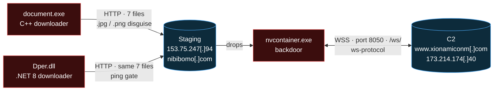

<div align="center">

# nvcontainer WebSockets Backdoor

### Reverse Engineering · C2 Protocol · Infrastructure Intelligence


*Independent analysis of a WebSocket backdoor, its two downloaders, and the servers behind them.*

</div>

---

> **TL;DR** — A small espionage toolset, publicly reported on Oct 14, 2026 and likely aimed at targets in Iraq. This repo rebuilds the **entire C2 protocol** from the binary without live traffic. It documents a **second, .NET downloader** with a ping gate, and maps the infrastructure into a **5-day build in early May 2026**. The C2 domain's DNS zone was edited **one day before the first sample surfaced**. The C2 server appears to be an **established business Windows server running Microsoft Dynamics NAV**, not a fresh rental. Six corrections made during the work are logged openly.

---

## 📌 At a glance

| | |
|---|---|
| **Analysis window** | Nov 2026 (artifacts dated May–Nov 2026) |
| **Components** | C++ downloader · .NET 8 downloader · `nvcontainer.exe` backdoor |
| **C2 transport** | WebSocket (`ws-protocol`) inside TLS, port 8050, via libwebsockets 4.3.99 |
| **Hosting** | InterServer, AS19318 (staging and C2) |
| **Prior public work** | dmpdump, Oct 14, 2026 |
| **Attribution** | **None made.** See [What this repo does not claim](#-what-this-repo-does-not-claim) |

---

## 🔎 Headline findings

**1 · The full C2 protocol, rebuilt statically.** All 11 send paths in the backdoor are mapped: the hello message, heartbeats, timers, the upload handshake, status messages and every server command. A reply bug makes every PONG start with **`[PONG]]`**. This was confirmed by emulating the code path offline.

**2 · A second downloader, in .NET.** `Dper.dll` pulls the same 7 files from the same server as the C++ `document.exe`, in the same order. It adds a **ping gate**: if 8.8.8.8 never answers a ping, it never fetches the payload, so sandboxes that block ICMP see no download. A cleanup bug leaves its status file on disk.

**3 · A 5-day infrastructure build.** The C2 domain was registered **May 3, 2026** and pointed at its server **May 5**. A second domain, **`nibibomo[.]com`**, was registered **May 6** and pointed at the staging server **May 8**. Both went through the same registrar reseller and the same DNS.

**4 · The C2 zone was edited the day before first sighting.** Its SOA serial is **`2026092800`**, which dates the edit to Sep 28. The sample surfaced on VirusTotal from Iraq on **Sep 29**. A control test rules out a provider-wide serial bump.

**5 · The C2 likely runs on someone else's server.** Port 8080 serves the **Microsoft Dynamics NAV** default page. MSMQ, IIS, RDP and SMB are exposed. The IP carried a business's TLS certificates continuously from **2015 to 2026**, and that business's hostname still resolves to it. The staging server, by contrast, is a fresh hosting template.

**6 · Hosting-template artifacts flagged as dead ends.** The staging server's TLS cert, JARM, default page, zone layout and nameserver are all shared with unrelated customers. They are listed as **EXCLUDED** so nobody pivots on them.

---

## 🗺️ How it fits together



More diagrams: [`assets/architecture-diagram.md`](assets/architecture-diagram.md)

---

## 🧭 Where to start reading

| If you want… | Start here |
|---|---|
| The reverse engineering of all three binaries | [`docs/technical-analysis.md`](docs/technical-analysis.md) |
| The full C2 protocol specification | [`docs/c2-protocol.md`](docs/c2-protocol.md) |
| The infrastructure map and hosting assessment | [`docs/infrastructure.md`](docs/infrastructure.md) |
| The dated timeline, May → Nov 2026 | [`docs/timeline.md`](docs/timeline.md) |
| What was corrected along the way | [`docs/retraction-log.md`](docs/retraction-log.md) |
| How the protocol was rebuilt | [`methodology/static-protocol-reconstruction.md`](methodology/static-protocol-reconstruction.md) |
| How the infrastructure was pivoted | [`methodology/pivot-methodology.md`](methodology/pivot-methodology.md) |
| The IOC inventory | [`iocs/`](iocs/) |
| A STIX 2.1 bundle | [`stix/nvcontainer-websockets-backdoor.json`](stix/nvcontainer-websockets-backdoor.json) |

---

## 📁 Repository contents

```
nvcontainer-websockets-backdoor/
├── README.md                              ← you are here
├── LICENSE                                ← CC BY 4.0
├── CHANGELOG.md                           ← version history
├── docs/
│   ├── technical-analysis.md              ← reverse engineering of all three binaries
│   ├── c2-protocol.md                     ← full WebSocket C2 protocol specification
│   ├── infrastructure.md                  ← server map, hosting assessment, exclusions
│   ├── timeline.md                        ← dated events, May → Nov 2026
│   ├── retraction-log.md                  ← six corrections, in order
│   └── disclosure.md                      ← sanitization and redaction notes
├── methodology/
│   ├── static-protocol-reconstruction.md  ← how the protocol was rebuilt without traffic
│   ├── pivot-methodology.md               ← passive infrastructure pivot chain
│   └── template-exclusions.md             ← how hosting-template artifacts were ruled out
├── queries/
│   ├── passive-dns-and-soa.md             ← DNS, passive DNS and SOA-serial checks
│   └── scan-engines.md                    ← Shodan / Censys / FOFA / ODIN lookups
├── iocs/
│   ├── README.md                          ← how to read the IOC files
│   ├── file-hashes.csv                    ← samples and staged files
│   ├── network-indicators.csv             ← domains, IPs, URLs, JA3
│   ├── host-artifacts.csv                 ← mutexes, paths, registry, file patterns
│   └── excluded-artifacts.csv             ← shared / template artifacts: do not pivot
├── stix/
│   └── nvcontainer-websockets-backdoor.json  ← STIX 2.1 bundle
└── assets/
    └── architecture-diagram.md            ← topology, kill chain, protocol diagrams
```

---

## 🎯 Confidence levels

| Finding | Confidence | Basis |
|---|---|---|
| One developer built both downloaders | Almost certain | Same staging IP, identical file table and order, shared `54321` mutex suffix, identical download logic |
| The client-side protocol map is complete | Almost certain | All 11 send calls in the binary mapped |
| The server-command map is complete | Highly likely | The receive handler is a single linear chain of string compares, read in full |
| `nibibomo[.]com` is the operator's staging domain | Highly likely | Pointed at the staging IP 2 days after registration, the same pattern as the C2 domain, on the server later used for staging |
| The C2 zone edit on Sep 28 was made by the domain owner | Almost certain | SOA serial against three control zones on the same DNS |
| The C2 runs on a legitimate business server | Likely (55–80%) | Dynamics NAV + MSMQ profile and the IP's 10-year history. The scan data is undated |
| The .NET build is older than the C++ build | Low confidence | PDB naming hints only |
| Operator identity / nationality | **Not assessed** | No attribution axes tested |

**Tags used throughout:** `NOVEL` (not public before) · `CORROBORATED` (independently confirmed) · `PUBLISHED` (prior public work) · `EXCLUDED` (shared or template artifact, do not pivot).

---

## ❓ Open questions

1. **Whose server is the C2?** It could be the prior tenant's own server, hijacked, or a reassigned IP. Settling it needs reverse DNS or host names from before May 2026, and none were found.
2. **What changed in the C2 zone on Sep 28?**
3. **Does `[DIS]` make the implant dormant until the next logon?**
4. **Is the May 4 staging build date the operator's?** It holds only if the Apache ETag `29af-650fed4d6e93f` is unique to that server.
5. **Are there other operator servers with the hostname `C2`?**

---

## 🚫 What this repo does not claim

- **No attribution.** dmpdump assessed a possible Iran nexus. This repo neither confirms nor rejects it. Other Iraq-focused activity in the same period was **not** compared technically, and no link is claimed.
- **No victim identification.** Targeting is described only as "likely Iraq," per the original public report.
- **No claim of compromise against a named party.** A third-party hostname that still resolves to the C2 IP is shown as `[REDACTED prior tenant]`.

---

## 🧪 How this was done

- **Static first.** IL disassembly (.NET), Capstone disassembly and string decoding (C++), and libwebsockets header and source cross-checks.
- **Offline emulation only.** One code path (the PONG reply) was run in Unicorn, with no network.
- **Sandbox reports, not detonation.** VirusTotal, Joe Sandbox and Triage artifacts were reviewed as provided. The Triage proxy effect is documented in the retraction log.
- **Passive infrastructure work only.** Passive DNS, CT logs, public DNS resolution, scan-engine records and archives. **Nothing touched the adversary's hosts.**

---

## 📚 Related work

- **dmpdump** — [New WebSockets Backdoor Likely Targeting Iraq](https://dmpdump.github.io/posts/websocketsbackdoor/) (Oct 14, 2026). The original public report: command set, `[LAL_P]` hello, `.vortexstamp` reuse, raw streaming of large files.
- **libwebsockets** — [v4.3-stable source](https://github.com/warmcat/libwebsockets/tree/v4.3-stable), used to confirm callback reasons, write modes and handshake headers.

---

## ⚖️ License

Published under [CC BY 4.0](https://creativecommons.org/licenses/by/4.0/). Use, share and adapt freely, with attribution.

## 🛡️ Responsible use

This repository documents real malicious infrastructure. Do not:

- Run the listed samples outside an isolated, offline environment
- Probe or connect to the listed hosts (passive lookups are fine)
- Use the protocol description to build or operate a compatible server

## ✉️ Contact

For corrections or additional findings, open an issue in this repository.

---

<div align="center">

*Independent research. Personal-time work using only publicly available data and the author's own offline analysis.*
*No commercial or institutional affiliation with any organization referenced.*

</div>
