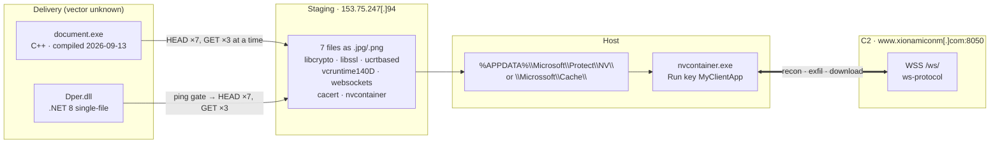
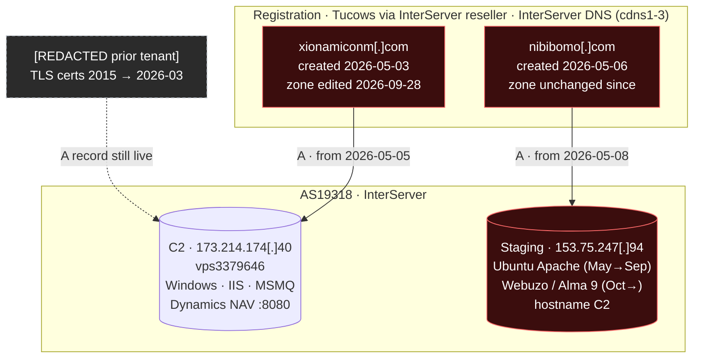
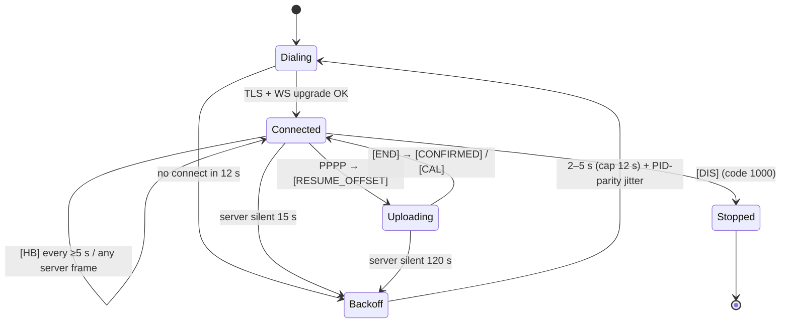
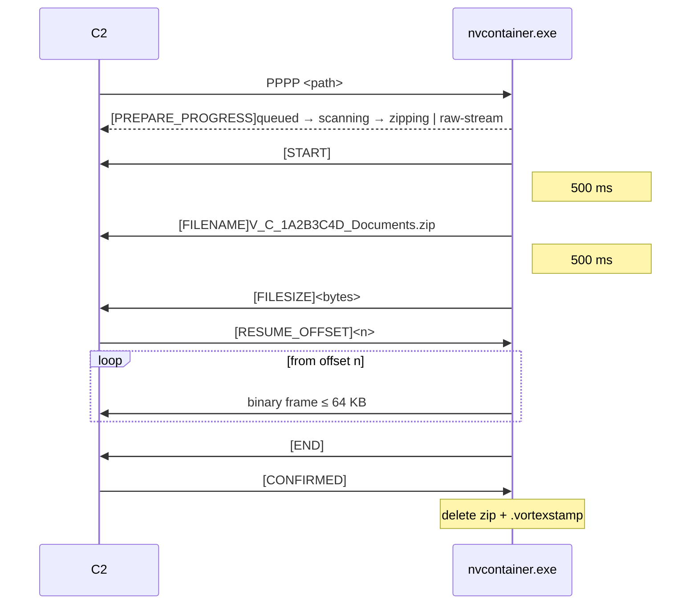

# Architecture Diagrams

All diagrams render natively on GitHub (Mermaid).

---

## 1. Kill chain (as observed)

---

## 2. Infrastructure topology

---

## 3. Backdoor state machine (connection layer)

---

## 4. Upload handshake

*The filename in the upload diagram is illustrative. It shows the `V_<drive>_<8hex>_<name>.zip` pattern.*
