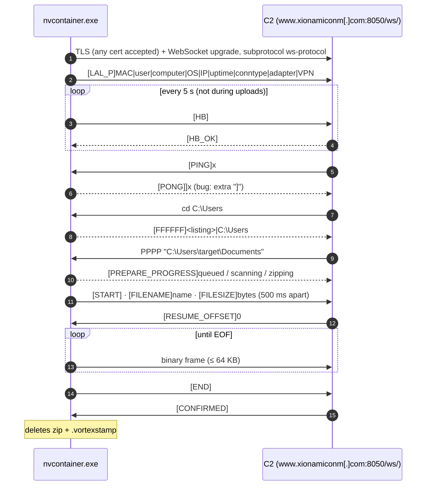

# C2 Protocol Specification — `nvcontainer.exe`

> **Tags:** command set, `[LAL_P]` hello and `ws-protocol` = PUBLISHED (dmpdump). Field order, timers, upload handshake, status tags, the PONG bug and the TLS consequence = NOVEL.

Rebuilt statically from the libwebsockets callback, with no live traffic.

**At a glance:** plaintext text commands in square-bracket tags, sent as WebSocket frames inside TLS. There is no encryption or encoding on top of TLS. Uploads are raw binary frames.

---

## 1. How it was rebuilt

- The `ws-protocol` entry in the libwebsockets protocol table is at `0x140041aa0`.
- The callback is at **`0x140006740`**, with a 64 KB receive buffer.
- **6 libwebsockets events are handled:** connection error (1), connected (3), receive (8), pong received (9), ready to send (10), closed (75). All others are ignored.
- **All 11 send calls** in the binary are mapped to the messages below.
- The PONG reply was confirmed by **offline emulation** (Unicorn).
- Event numbers and write modes were checked against the libwebsockets v4.3-stable headers.

---

## 2. Connection

| Item | Value |
|---|---|
| Target | `www.xionamiconm[.]com:8050`, path `/ws/` |
| TLS | libwebsockets flags = 7: TLS on, self-signed certs allowed, hostname not checked |
| Subprotocol | `ws-protocol` |
| Handshake | `GET /ws/`, `Pragma: no-cache`, `Cache-Control: no-cache`, `Host: www.xionamiconm[.]com`, WebSocket version 13. **No User-Agent** |
| Origin | Probably `https://www.xionamiconm[.]com` (libwebsockets default). Not verified |
| JA3 (VT sandbox) | `5a1edc7f170af1014fc65c994878e63c` |

**Consequence:** the implant accepts any certificate. TLS inspection does not break it, and it exposes the whole protocol in plaintext.

---

## 3. Session flow

1. **Hello.** Sent on connect as one text frame:
   `[LAL_P]MAC|user|computer|OS|IP|uptime|conntype|adapter|VPN`
   - **MAC:** uppercase, colon-separated.
   - **Uptime:** in seconds.
   - **Connection type:** `wifi`, `eth`, `cell` or `unknown`.
   - **VPN:** `none` or the VPN type.
   - **Sanitizing:** spaces, `|`, CR and LF are replaced with `_`. Example OS field: `Windows_11_-_build_22631`.
2. **Heartbeat.** The client sends `[HB]` (4 bytes) every 5 s or more, but not during uploads. The server answers `[HB_OK]`.
3. **Liveness.** If the server is silent for **15 s** (**120 s** during an upload or archive build), the client reconnects.
4. **Reconnect.** A connection attempt times out after 12 s. The backoff runs 2–5 s and rises to a 12 s cap when connections keep dropping within 3 s. It adds 0 or 1 s depending on whether the process ID is odd or even.

---

## 3a. Session diagram

---

## 4. Server commands and client replies

| Server sends | Client does / replies |
|---|---|
| `[HB_OK]` | Updates its last-activity time |
| `[PING]x` | Replies `[PONG]]x` (**bug: extra `]`**) |
| `1` | `[RRRRRR]C:\` + newline + `D:\` … |
| `2` | `[VVVVVV]` + drive report: type, file system, label, serial, plus encryption flags (VeraCrypt, TrueCrypt, BitLocker, LUKS) |
| `cd <path>` | `[FFFFFF]<listing>\|<path>`. Listing lines are `[DIR] name` or `[FILE] name`. **The listing comes first; the path follows the `\|`** |
| `DDDD "url" "dir"` | Sends `[LS]`, calls URLDownloadToFileW, then sends `[LD]` (success) or `[LE]` (error). **Saves the file only. Never runs it** |
| `PPPP <path>` | Archives the path and uploads it (section 5) |
| `[RESUME_OFFSET]n` | Seeks to offset n and starts streaming |
| `[CONFIRMED]` / `[CON]` | Deletes the zip and its `.vortexstamp` |
| `[CAL]` | Cancels the upload. No reply |
| `[DIS]` | Closes with code 1000 ("Server requested disconnect") and stops reconnecting. How long it stays dormant is unresolved |

---

## 5. Upload handshake

1. **Client:** `[PREPARE_PROGRESS]queued`, then `scanning`, then `zipping` or `raw-stream`.
2. **Client:** `[START]`, `[FILENAME]<name>`, `[FILESIZE]<bytes>`, with **500 ms** between each.
3. **Server:** `[RESUME_OFFSET]<n>`.
4. **Client:** binary frames of **up to 64 KB**, starting at offset n.
5. **Client:** `[END]`.
6. **Server:** `[CONFIRMED]` or `[CON]`.

**Failures:** `[PREPARE_FAIL]<reason>`. A zip failure includes the **build tag `v6`** and the exit codes from tar.exe and PowerShell.

**Not sent to the C2:** JSON diagnostics (`{"build":...}`) stay local. No send call carries them.

---

## 6. PONG bug (emulated)

| Input | Bytes sent |
|---|---|
| `[PING]` | `[PONG]]` (7 bytes, text frame) |
| `[PING]abc123` | `[PONG]]abc123` |

**Cause:** the reply copies from position 5 of the received message instead of position 6. **Every PONG on the wire starts with `[PONG]]`.**

---

## 7. Gaps

- The Origin header format: depends on a libwebsockets context option, not checked.
- Whether `[DIS]` makes the implant dormant until relogon.
- The staging folder for zips.
- Server-side behavior is still unseen on the wire.
