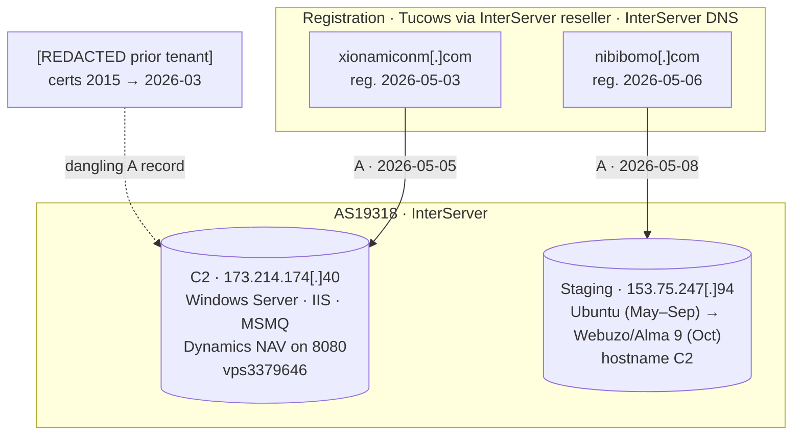

# Infrastructure Intelligence

> All findings are from passive third-party data. Template artifacts are listed in section 5 as EXCLUDED.

Mapped passively from third-party data only: passive DNS, CT logs, public DNS resolution, scan-engine records and archives. Nothing touched the adversary's hosts.

---

## 1. Map

| Node | Role | Notes |
|---|---|---|
| `xionamiconm[.]com` + `www` | C2 domain | Resolves to 173.214.174[.]40 |
| 173.214.174[.]40 | C2 server | AS19318 InterServer. Reverse DNS `vps3379646.trouble-free[.]net` (ODIN, Oct 11, 2026). Windows Server |
| `nibibomo[.]com` + `www` + `mail` | Staging domain | Resolves to 153.75.247[.]94 |
| 153.75.247[.]94 | Staging server | AS19318 InterServer, block 153.75.224.0/19 (registered 2026-04-14). Hostname `C2` |
| `[REDACTED prior tenant]` | Earlier hostname on the C2 IP | Still resolves to the C2 IP. Dangling DNS |

**Registration:** both domains were registered through Tucows via the InterServer reseller and use InterServer DNS (`cdns1-3.interserver.net`). The registrant states differ (`TX` and `ms`).

---

## 2. Build timeline (UTC)

| Date | Event | Source |
|---|---|---|
| 2026-04-14 | Staging IP block registered to InterServer | WHOIS |
| **2026-05-03** 13:31 | C2 domain registered | WHOIS |
| 2026-05-04 14:34:43 | Ubuntu Apache default page written on the staging IP (ETag `29af-650fed4d6e93f`) | FOFA, Sep 17 record |
| **2026-05-05** | C2 domain → C2 IP | OTX passive DNS |
| **2026-05-06** 05:49 | `nibibomo[.]com` registered. Its zone has not changed since (SOA serial `2026050601`) | WHOIS, SOA |
| **2026-05-08** | `nibibomo[.]com` → staging IP | OTX passive DNS |
| 2026-09-13 | C++ downloader compiled with the staging IP | PE header |
| 2026-09-14 | `nibibomo[.]com` registry record updated. The DNS zone did not change | WHOIS, SOA |
| 2026-09-17 | Staging IP running Ubuntu Apache 2.4.52, `nibibomo[.]com` pointing to it | FOFA |
| **2026-09-28** | **C2 zone edited** (SOA serial `2026092800`). What changed is unknown | SOA |
| 2026-09-29 | `document.exe` uploaded to VirusTotal from Iraq | dmpdump |
| 2026-10-11 | Staging served the 7 files to a VirusTotal sandbox. C2 reached on 8050 (JA3 recorded) | VirusTotal |
| 2026-10-11/12 | C2 IP reverse DNS `vps3379646.trouble-free[.]net`, SMB live | ODIN |
| 2026-10-14 | Public write-up | dmpdump |
| By 2026-10-15 | Staging rebuilt on the InterServer Webuzo / AlmaLinux 9 template, hostname `C2` | Shodan |
| 2026-10-15, 10-16 | Sandbox runs got no content from staging | Triage |
| 2026-11-01 | Staging port 80 still answers (403). Later the same day, Censys sees only panel ports 2002–2005 | FOFA, Censys |
| 2026-11-03 | C2 IP reverse DNS shows no value | Censys |
| 2026-11-08 | No SYN-ACK from staging port 80 | Joe Sandbox |

**SOA control test:** three unrelated zones on the same InterServer DNS carry serials `2022091301`, `2025113007` and `2026041001`. So Sep 28 was **not** a provider-wide serial bump.

---

## 3. Staging server (153.75.247[.]94)

- **Services:** Webuzo panel (2002–2005), Apache (80/443, 403 on `/`), Exim (25/465/587), Dovecot (110/143/993/995), BIND (53, recursion refused), MariaDB (3306), OpenSSH 9.9.
- **Hostname `C2`** appears in both the Exim banner and BIND. Hostnames are set per server: an unrelated customer on the same template uses `wp-server`.
- **SSH host key** SHA-256 `798ad809d1291343474a939048fe4922325514751a247252b24f1a760bbddf74`. It doesn't match the template control server's ECDSA key. The key type on staging isn't confirmed.
- **Two builds over time:**
  - An Ubuntu Apache box from May 4 to at least Sep 17.
  - The Webuzo template by Oct 15.
  - The rebuild falls between those dates. Whether it was a reaction to the Oct 14 write-up is a **roughly even** call.

---

## 4. C2 server (173.214.174[.]40)

**FOFA (undated export) shows a Windows Server:**

| Ports | Meaning |
|---|---|
| 135, 139, 445, 49664–49671 | Windows SMB and RPC |
| 3389, 5985, 47001, 22 | RDP, WinRM, SSH |
| 80 | IIS default page |
| 8080 | **Microsoft Dynamics NAV** Web Server Components default page |
| 1801, 2105, 2107 | MSMQ (not a Windows default) |
| 8871 | TLS, service unknown |

**Other sources:**
- **Shodan:** no record at all. **Censys:** 0 services, with a possible blocklist entry. FOFA and ODIN do see the host. This fits either scanner blocking or an opt-out request. The cause is unknown.
- **urlscan:** could not reach `http://xionamiconm[.]com/` on Oct 15 or Oct 29.

**Prior tenant:**
- `[REDACTED prior tenant]` held Comodo/Sectigo certs from **2015 through the last one issued Feb 2025**, expiring Mar 15, 2026. No renewal followed.
- Passive DNS links that hostname to the IP back to 2023.
- The tenant's DNS zone was edited Aug 27, 2026, and **the record still points at the C2 IP**.

**Assessment: likely (55–80%) the C2 runs on a legitimate business server**, either hijacked or reassigned.

| Hypothesis | For | Against |
|---|---|---|
| Prior tenant's server, hijacked | 10-year cert history. The record was kept in a zone edited Aug 2026. The Windows/NAV profile fits | No direct sign of compromise |
| IP reassigned to another business, then hijacked | Cert renewals stopped in early 2026 | No data on a new tenant |
| Operator's own rental | — | NAV and MSMQ are unlikely on a fresh rental |

**Caveat:** the FOFA export is undated. The NAV page could predate the C2 era. Only SMB is confirmed live during that era (ODIN, Oct 12).

**Contrast:** staging is a freshly built template, while the C2 is an established business host. That suggests the operator **rented staging but used someone else's server for C2.**

---

## 5. Excluded (do not pivot)

| Artifact | Why |
|---|---|
| Staging TLS cert `CN=alma9.ispot.cc` (serial `07:73:5a:a4:…:66:ce`), JARM `3fd3fd15d3fd3fd00042d42d000000a0d14c559c674ff8857d4e511e7563d1` | Same cert on an unrelated InterServer customer (redacted). It ships with InterServer's Webuzo / AlmaLinux 9 template |
| Webuzo default page (Last-Modified May 31, 2026) | Written 36 s after the template cert |
| Server timezone (-0400 / -0500) | Provider default |
| Exim, Dovecot, BIND, MariaDB, panel ports | Webuzo default install |
| Zone layout (`www`, `mail`, `MX 25 mail.<domain>`, no TXT) | InterServer DNS default. An unrelated zone is identical |
| Nameserver `cdns1.interserver.net` | 13,108 domains use it |
| Scanner EHLO names and 224.x addresses in banners | The scanners' own identities |
| Stock OpenSSL and runtime DLL hashes | Shared with unrelated malware and software |

---

## 6. Null results

- **Wayback Machine:** nothing for either domain or the staging IP.
- **CT logs:** no certificates for either domain.
- **Subdomains:** only `www` and `mail`.
- **Public reporting:** none on `nibibomo[.]com`.
- **OTX:** no pulses on the C2 IP.
- **ThreatCluster:** nothing.
- **Censys history:** only 7 days available on the plan used, so no data before May 2026.
