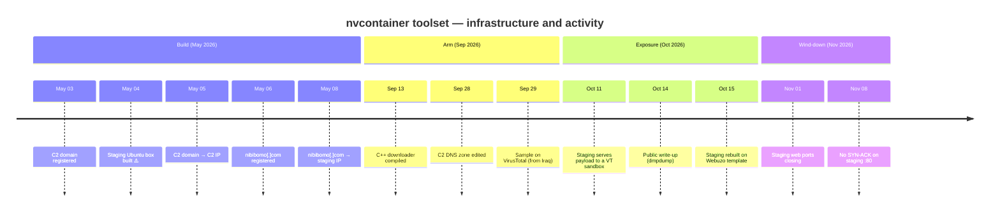

# Timeline — May → November 2026

All times are UTC. The **Source** column says where each fact comes from. Rows marked ⚠️ carry a caveat.

---

## Detailed table

| Date (UTC) | Event | Source |
|---|---|---|
| 2015-01-22 | First TLS certificate for the prior tenant's hostname that later resolves to the C2 IP | CT logs |
| 2023-02-19 | Passive DNS ties the prior tenant's hostname to 173.214.174[.]40 | OTX |
| 2025-02-12 | Last certificate issued for the prior tenant's hostname (expires 2026-03-15). No renewal follows | CT logs |
| 2026-04-14 | Block 153.75.224.0/19 (the staging IP's block) registered to InterServer | WHOIS |
| **2026-05-03 13:31** | **`xionamiconm[.]com` registered** (Tucows via InterServer reseller, InterServer DNS) | WHOIS |
| 2026-05-04 14:34:43 | ⚠️ Ubuntu Apache default page written on the staging IP. Decoded from ETag `29af-650fed4d6e93f`. Uniqueness not tested | FOFA |
| **2026-05-05** | **`xionamiconm[.]com` → 173.214.174[.]40** | OTX passive DNS |
| **2026-05-06 05:49** | **`nibibomo[.]com` registered.** Its zone has not changed since (SOA `2026050601`) | WHOIS, SOA |
| **2026-05-08** | **`nibibomo[.]com` → 153.75.247[.]94** | OTX passive DNS |
| 2026-05-31 16:34 | InterServer Webuzo / AlmaLinux 9 template built (cert date). Template, not operator | Cert, default page |
| 2026-08-27 | The prior tenant edits its DNS zone and **keeps** the record pointing at the C2 IP | SOA |
| 2026-09-13 11:27 | C++ downloader `document.exe` compiled | PE header |
| 2026-09-14 11:13 | `nibibomo[.]com` registry record updated. The DNS zone did not change | WHOIS, SOA |
| 2026-09-17 | Staging IP still runs Ubuntu Apache 2.4.52, and `nibibomo[.]com` points to it | FOFA |
| **2026-09-28** | **C2 DNS zone edited** (SOA `2026092800`). What changed is unknown | SOA |
| **2026-09-29** | **`document.exe` uploaded to VirusTotal from Iraq** | dmpdump |
| 2026-10-11 ~13:30 | Staging serves all 7 files to a VirusTotal sandbox. The backdoor reaches the C2 on 8050 | VirusTotal |
| 2026-10-11 / 12 | C2 IP reverse DNS `vps3379646.trouble-free[.]net`. SMB live | ODIN |
| 2026-10-14 | Public write-up | dmpdump |
| 2026-10-15 | Staging seen rebuilt on the Webuzo / AlmaLinux 9 template, hostname `C2` | Shodan |
| 2026-10-15 / 16 | Two Triage runs get no content from staging. A transparent proxy masks the TCP state | Triage |
| 2026-10-15 / 29 | urlscan cannot reach `http://xionamiconm[.]com/` | urlscan |
| 2026-11-01 03:52 | Staging port 80 still answers (403) | FOFA |
| 2026-11-01 20:00 | Censys sees only staging panel ports 2002–2005 | Censys |
| 2026-11-03 | C2 IP reverse DNS shows no value | Censys |
| 2026-11-05 / 06 | Both C2 names, and the prior tenant's name, still resolve to the C2 IP | Censys |
| 2026-11-08 22:23 | No SYN-ACK from staging port 80 | Joe Sandbox |

---

## Gaps in the timeline

- **The rebuild of the staging server** happened somewhere between Sep 17 and Oct 15. Whether it reacted to the Oct 14 write-up is a **roughly even** call.
- **The backdoor's build date is hidden.** `/Brepro` replaces the PE timestamp with a hash.
- **The first malicious use of the C2 IP** is unknown. Passive DNS only shows when the C2 domain first resolved to it (May 5).
