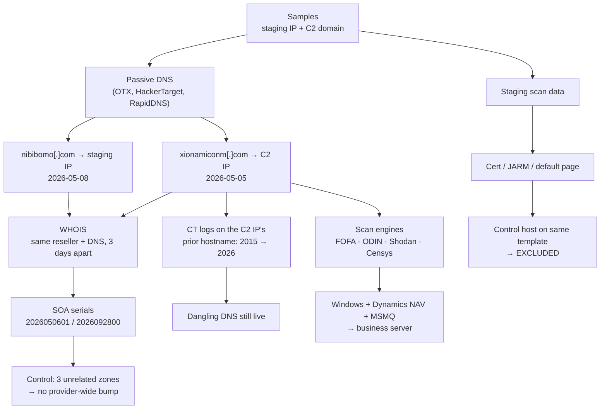

# Passive Pivot Methodology

The infrastructure chain, step by step. Every step used third-party data only. **No request was ever sent to the operator's hosts.**

---

## Step 1 — Passive DNS on both IPs

- **OTX** passive DNS by IP returned the C2 domain (first seen May 5) and `nibibomo[.]com` (May 8).
- **HackerTarget** and **RapidDNS** reverse-IP lookups confirmed the same names, plus the prior tenant's hostname on the C2 IP.

## Step 2 — WHOIS on both domains

Both were registered through Tucows via the InterServer reseller, use InterServer DNS, and were registered 3 days apart. The registrant states differ.

## Step 3 — SOA serials as change dates

InterServer DNS writes serials as `YYYYMMDDnn`.

| Zone | Serial | Reading |
|---|---|---|
| `nibibomo[.]com` | `2026050601` | Never edited after creation |
| `xionamiconm[.]com` | `2026092800` | Edited **Sep 28, 2026** |

**Control test:** three unrelated zones on the same DNS returned `2022091301`, `2025113007` and `2026041001`, so serials are per zone, not provider-wide.

## Step 4 — Certificate history on the C2 IP

CT logs for the prior tenant's hostname show a continuous chain of certificates from **2015-01-22 to the last one issued 2025-02-12**, expiring 2026-03-15. No renewal followed. Public DNS shows that hostname **still resolves** to the C2 IP, and its zone was edited 2026-08-27.

## Step 5 — Scan-engine profile of the C2 IP

| Engine | Result |
|---|---|
| FOFA (undated export) | Windows Server: SMB, RPC, RDP, WinRM, SSH, IIS, **Dynamics NAV (8080)**, MSMQ, TLS on 8871 |
| ODIN | Reverse DNS `vps3379646.trouble-free[.]net`. SMB live Oct 12, 2026 |
| Shodan | No record at all |
| Censys | 0 services, with a possible blocklist entry. 7-day history only on the plan used |

The 8080 page title, "Web Server Components Site Container", was identified as the Microsoft Dynamics NAV default page by matching it against other NAV servers.

## Step 6 — Template exclusion on the staging server

See [template-exclusions.md](template-exclusions.md).

## Step 7 — Null-result sweep

Wayback Machine, CT for both domains, subdomain enumeration, public web search, ThreatCluster, OTX pulses and Malwarebytes reputation were all checked. **All came back empty.** Null results are recorded in [../docs/infrastructure.md](../docs/infrastructure.md).

---

## Reproducing it

The exact lookups are in [../queries/](../queries/).
